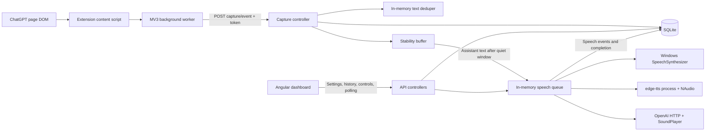

# Architecture

Current implementation reviewed on 2026-11-11. This documents the existing application rather than a proposed design.

## Components and flow

The ASP.NET Core process binds to loopback at port 17832. Angular runs separately at port 4200; the backend does not host the frontend. The dashboard polls HTTP endpoints; no SignalR connection is implemented.

## Capture path

1. `dom-adapter.js` tries three selector sets, preferring `main [data-message-author-role]`. It extracts paragraph, list, and code text, avoids some overlapping nodes, and collapses consecutive identical extracted lines.
2. `content-script.js` scans on attachment and DOM mutations. It derives a role and source ID, suppresses unchanged text per source, and sends a `capture-event` runtime message. IDs fall back to DOM element identities when page attributes are unavailable.
3. `background.js` reads extension settings, skips forwarding when disabled, and posts JSON with `X-Reader-Token` to the local API. It also attaches scripts to existing ChatGPT tabs, with a guard against duplicate injection.
4. `CaptureController` authenticates capture, rejects blank text, computes a SHA-256 hash when needed, and creates or updates the stored message by source ID and the latest session ID.
5. `MessageDeduper` compares the latest text hash for a key formed from conversation ID and source ID (falling back to role). Changed text passing the reading-role setting enters `StabilityBuffer`.
6. `StabilityBuffer` replaces the pending snapshot for that key. After the quiet window, it removes the snapshot and enqueues it only when the role is assistant.

The deduper result returned as `shouldSpeak` means text changed according to that service; it does not confirm playback or role eligibility.

## Speech execution

`SpeechQueue` is a hosted background service with an unbounded in-memory channel. It processes one item at a time and loads runtime settings from SQLite for each item. History Play bypasses capture eligibility and enqueues stored text directly.

- Local mode uses Windows `SpeechSynthesizer` and its progress events.
- Edge mode splits text into segments, invokes `edge-tts`, writes temporary audio, and plays it with NAudio. Position is estimated from audio duration.
- Cloud mode splits text and sends each segment to the hard-coded OpenAI speech endpoint. It requests WAV audio and plays the response synchronously through Windows `SoundPlayer`. Pause takes effect between segments.
- Edge and Cloud split text at newlines and `.`, `!`, `?`; delimiters are removed. Tracker offsets are therefore approximate.
- Speech-event statuses include `queued`, `started`, `completed`, `skipped`, and `failed`. Events are created when processing begins, rather than as a durable queue at initial enqueue time. Successful completion updates the message's `SpokeAt`.

## Persistence and runtime state

| Entity | Purpose |
| --- | --- |
| `AppSetting` | Unique string key/value settings, including speech configuration |
| `CapturedMessage` | Role, text/hash, source ID, session ID, timestamps, last completed speech time |
| `SpeechEvent` | Message ID, status, timestamps, and error |
| `ConversationSession` | Site and session timestamps |
| `SiteProfile` | Site, selector version, and enabled flag; not currently used to drive extension selectors |

`AppDbContext` uses EF Core SQLite and `EnsureCreated()` at startup. See [database lifecycle](migrations.md). The database persists; queued speech, deduper hashes, pending stability snapshots, tracker state, and repeat state are process-local.

## Current limitations

- Capture reuses the latest database session and creates one only when none exists. Incoming conversation IDs affect deduplication keys but are not stored as isolated conversations. Source IDs can collide across tabs or reloads.
- Only assistant messages leave the stability buffer, even if user reading is enabled.
- Capture forwarding has no retry queue. The content script marks text as sent before network success, so an unchanged failed update is not automatically retried.
- A quiet window is a timing heuristic, not a provider signal that generation is complete. Later updates can queue another snapshot of the same message.
- Stop drains the speech channel but does not clear pending stability updates or disable capture.
- Voice lists may be built-in fallbacks; an available list does not establish that synthesis works.
- There is no per-conversation queue, durable queue recovery, installer, implemented rate limiter, or authenticated multi-user control plane.

## Access and data boundaries

Only capture checks `X-Reader-Token`. Settings, history, speech controls, voices, and diagnostics do not require that token. CORS permits ChatGPT domains and localhost/127.0.0.1 on port 4200; it is not authentication. Keep the current service on loopback.

Captured text and the Cloud API key are stored in SQLite without application-level encryption. Settings GET returns stored values, including that key. Extension settings use `chrome.storage.sync`. Local speech stays on the machine; Edge and Cloud send spoken text to their services. See [configuration](configuration.md).
